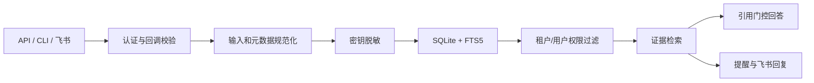

# 知澜（InfoMemory Agent）

> 把散落在消息、文档和本地文件里的信息，变成可追溯、可检索、按权限隔离的团队记忆。

[](https://github.com/zzbaichuan-glitch/infomemory-agent/actions/workflows/ci.yml)
[](https://github.com/zzbaichuan-glitch/infomemory-agent/actions/workflows/codeql.yml)

当前版本：`0.3.0`。项目仍处于 pre-1.0 阶段，但已从演示型 MVP 升级为可本地使用、可容器部署、具备真实飞书安装基础和明确生产安全边界的模块化单体。

## 现在能做什么

- 从 HTTP API、跨平台 CLI 和飞书文本事件写入记忆。
- 在持久化、索引、日志、LLM 和提醒派生之前，统一清洗正文、标题和来源元数据中的常见密钥、令牌、密码与私钥。
- 使用 SQLite FTS5 全文检索；所有读取在数据库查询层执行租户、所有者和可见性过滤。
- 生成基于证据的回答；有效陈述必须带 `[S1]` 引用，否则自动安全降级为证据列表。
- 支持资产游标分页、条件过滤、详情读取和所有者删除。
- 支持手动提醒、会议时间识别、提醒状态机和进程内通知 worker。
- 支持飞书回调 Token、Encrypt Key 解密、签名时效校验、事件幂等，以及“搜索 / 问 / 帮助”命令回复。
- 支持企业自建应用 OAuth 安装：一次性 state 防 CSRF、租户绑定、PKCE S256、授权码交换、AES-256-GCM 凭据持久化、安装状态查询、撤销和 refresh-token 轮换。
- 生产环境的飞书 webhook 使用持久化 inbox/outbox：安全入队后快速 ACK，后台 worker 按租约、退避、死信和幂等出站任务恢复处理。
- 开发环境可使用可信身份头；生产环境强制使用严格校验的 HS256 Bearer Token。
- 提供统一错误结构、请求 ID、速率限制、结构化脱敏日志、存活/就绪探针和 OpenAPI。
- 提供 PowerShell 脚本、Docker Compose、Windows/Linux CI、CodeQL 和 Dependabot。

| 能力 | 当前状态 | 边界 |
|---|---|---|
| 本地文件与手工信息 | 可用 | UTF-8 文本通过 CLI/API 写入 |
| 飞书消息接入 | 可用 | 文本事件、验证、加密、签名、幂等 |
| 飞书搜索与问答 | 试点可用 | production 默认持久化 inbox/outbox 异步处理；开发/测试默认同步，便于本地调试 |
| 飞书企业 OAuth 安装 | 可用（首批产品能力） | 需在开放平台登记精确回调地址；云文档增量同步与 ACL 撤销传播仍需后续接入 |
| 飞书云文档同步 | 待扩展 | OAuth 凭据基础已具备，尚无增量同步与 ACL 撤销传播 |
| 飞书任务队列 | 可用（单实例试点） | SQLite 持久化 inbox/outbox、租约、重试、死信和管理员操作；出站为至少一次投递 |
| 检索 | 可用 | SQLite FTS5；尚无向量检索与重排 |
| LLM 问答 | 可选 | OpenAI-compatible；失败时安全降级 |
| 多实例部署 | 待扩展 | SQLite + 进程内 worker 适合单实例试点 |
| Web 工作台 | 可用 | 同源单页工作台；桌面 GUI 仍待扩展 |

## 安全模型



关键约束：

- `trusted_headers` 仅允许 development/test，production 会拒绝启动。
- Bearer Token 严格校验算法、签名、issuer、audience、时效、租户、用户和角色。
- 租户共享写入需要 `asset:share_tenant` 权限或 `knowledge_manager` 角色。
- 幂等范围包含租户、用户、操作和请求指纹；同一 key 配不同请求会冲突。
- 标题、正文、外部 ID 和来源 URL 都经过安全规范化；URL 仅接受安全协议。
- 飞书配置 Encrypt Key 后拒绝明文降级，签名采用恒定时间比较并限制时间窗口。
- OAuth state 只保存 SHA-256 摘要且一次性消费；PKCE verifier 与 OAuth 凭据均仅保存 AES-256-GCM 密文。
- connector payload、队列错误和日志均脱敏；队列状态接口不返回 payload、密文或错误正文。
- 本项目不是密码库。真实密钥应进入 Secret Manager，知澜只保存安全引用。

详细边界见 [SECURITY.md](SECURITY.md)。

## 项目结构

```text
apps/api/                 Fastify API、认证、飞书适配器、Token 工具与 Web 工作台
apps/api/public/          同源工作台 HTML/CSS/JS（无额外前端依赖）
packages/core/            领域服务、脱敏、检索、提醒、SQLite 仓储与迁移
scripts/                  安装、开发、验证、审计、冒烟与知澜 CLI
docs/api/openapi.yaml     OpenAPI 3.1 契约
docs/architecture/        架构与安全不变量
docs/plans/               PRD、实施计划和设计记录
.github/workflows/        CI 与 CodeQL
Dockerfile                非 root 多阶段镜像
compose.yaml              单实例部署示例
```

## 快速开始

要求 Node.js 24+、npm 11+；PowerShell 入口建议使用 PowerShell 7。

### 安装

```powershell
powershell -ExecutionPolicy Bypass -File .\scripts\install.ps1
```

实际调用链：

```text
scripts/install.ps1
└─ npm ci --cache .npm-cache --registry https://registry.npmjs.org
   ├─ 根 workspace
   ├─ packages/core
   └─ apps/api
```

跨平台可直接运行 `npm ci --registry=https://registry.npmjs.org`。

### 配置与开发启动

```powershell
Copy-Item .env.example .env.local
powershell -ExecutionPolicy Bypass -File .\scripts\dev.ps1
```

实际调用链：

```text
scripts/dev.ps1
└─ npm run dev --workspace @infomemory/api
   ├─ predev: npm run build --workspace @infomemory/core
   └─ tsx watch apps/api/src/server.ts
```

本地默认使用 `NODE_ENV=development`、`AUTH_MODE=trusted_headers`，并关闭 LLM 和飞书出站通知。`.env.local` 已被 Git 忽略。

默认端点：

- `GET /health/live`：存活
- `GET /health/ready`：SQLite 就绪
- `GET /health`：兼容健康页
- `GET /openapi.yaml`：OpenAPI 文档

### Web 工作台

启动 API 后打开 [http://127.0.0.1:3000/app/](http://127.0.0.1:3000/app/)（根路径 `/` 也可访问）即可使用内置工作台。工作台是同源、无前端构建依赖的单页应用，覆盖：

- 身份配置（development 的 trusted headers、production 的 Bearer token）；
- 记忆写入、分页列表、详情查看与所有者删除；
- 权限过滤的关键词检索和证据问答；
- 提醒创建、状态流转和删除；
- API、LLM、飞书回调与出站通知能力状态；
- 在服务启用 Feishu OAuth 时发起租户安装、查看非敏感安装状态和撤销安装。
- 在服务启用 Feishu OAuth 时由租户管理员手动刷新安装凭据；工作台不会把凭据或 Bearer token 写入浏览器存储。

实际调用链：

```text
浏览器 GET /app/
└─ apps/api/src/routes/workbench.ts
   ├─ apps/api/public/index.html
   ├─ apps/api/public/styles.css
   └─ apps/api/public/app.js

工作台操作
└─ 同源 HTTP /v1/*
   ├─ trusted headers：x-tenant-id + x-user-id
   └─ bearer：Authorization: Bearer <token>
```

开发模式示例：

```powershell
$env:NODE_ENV = "development"
$env:AUTH_MODE = "trusted_headers"
powershell -ExecutionPolicy Bypass -File .\scripts\dev.ps1
```

然后在工作台中填写租户 ID 和用户 ID。生产模式必须使用 Bearer token；令牌只保存在当前页面内存，工作台不会把令牌写入 `localStorage`/`sessionStorage`，勾选“记住租户/用户身份”也只保存非敏感的租户与用户提示。不要在截图、聊天记录或 URL 中分享令牌。工作台不会读取或展示 `AUTH_SECRET`、飞书 App Secret、Verification Token、Encrypt Key 或 LLM API key。

工作台静态页面本身可以匿名打开，但所有 `/v1/*` 业务请求仍由 API 认证和权限层保护；生产入口必须使用 HTTPS，并建议在反向代理层配置 CSP、HSTS、访问日志脱敏和同源域名策略。工作台只允许同源脚本、样式和 API 请求，页面响应带 `Cache-Control: no-store`、`X-Frame-Options: DENY` 等安全响应头。

工作台的提醒日期输入使用浏览器本地时区转换为 ISO 时间，再由服务端按 `APP_TIMEZONE` 和业务规则校验；跨时区协作时请在提交前确认显示的时间。

### 使用 CLI

开发模式先设置身份：

```powershell
$env:INFOMEMORY_TENANT_ID = "demo-tenant"
$env:INFOMEMORY_USER_ID = "alice"
```

常用命令：

```powershell
npm run agent -- health
npm run agent -- ingest --file .\README.md --title "知澜项目说明"
npm run agent -- assets --limit 20
npm run agent -- search 知澜 安全
npm run agent -- ask 知澜的安全边界是什么
npm run agent -- remind --title "项目复盘" --starts-at "2026-09-01T02:00:00.000Z"
npm run agent -- reminders --status scheduled
npm run agent -- reminder-delete <reminder-id>
npm run agent -- --help
```

入口链：

```text
npm run agent -- <command>
└─ node scripts/zhilan.mjs

powershell -File scripts/zhilan.ps1 <command>
└─ node scripts/zhilan.mjs
```

## 生产认证

真实部署应由 Secret Manager 注入至少 32 字节的随机密钥。下面仅演示本地 PowerShell：

```powershell
$env:AUTH_SECRET = [Convert]::ToBase64String([Security.Cryptography.RandomNumberGenerator]::GetBytes(48))
$env:AUTH_MODE = "bearer"
$env:AUTH_ISSUER = "infomemory-agent"
$env:AUTH_AUDIENCE = "infomemory-api"
$env:INFOMEMORY_TOKEN = npm run --silent token -- --tenant acme --user alice --roles member --expires-in 8h
```

Token 调用链：

```text
npm run token -- <args>
└─ npm run token --workspace @infomemory/api --
   └─ tsx apps/api/src/cli/generate-access-token.ts
      └─ apps/api/src/auth/access-token.ts
```

租户共享资产需要 `--roles member,asset:share_tenant` 或 `knowledge_manager`。生产还必须在入口层终止 HTTPS，并做好密钥轮换、备份加密与监控告警。

## HTTP API

| 方法 | 路径 | 用途 |
|---|---|---|
| GET | `/health/live` | 进程存活 |
| GET | `/health/ready` | SQLite 就绪 |
| GET | `/openapi.yaml` | OpenAPI 3.1 |
| POST | `/v1/assets` | 写入；必须带 `idempotency-key` |
| GET | `/v1/assets` | 游标分页与过滤 |
| GET/DELETE | `/v1/assets/:id` | 授权详情 / 所有者删除 |
| POST | `/v1/search` | 权限过滤的证据检索 |
| POST | `/v1/answers` | 引用门控问答 |
| POST/GET | `/v1/reminders` | 创建 / 查询提醒 |
| DELETE | `/v1/reminders/:id` | 删除当前用户自己的提醒 |
| POST | `/v1/reminders/:id/status` | 推进提醒状态 |
| POST | `/v1/connectors/feishu/events` | 飞书回调 |
| GET | `/v1/admin/connectors/queue` | 租户范围的 connector inbox/outbox 状态（需管理员权限） |
| POST | `/v1/admin/connectors/queue/{inbox,outbox}/{id}/{retry,cancel}` | 管理队列重试或取消 |

完整请求、响应、认证和错误结构见 [OpenAPI](docs/api/openapi.yaml)。普通 API 错误都包含稳定 `error`、安全 `message` 和 `requestId`。

## 飞书接入

1. 在飞书开放平台创建企业自建应用并启用机器人。
2. 配置事件地址 `https://你的域名/v1/connectors/feishu/events`。
3. 订阅 `im.message.receive_v1`，配置 Verification Token；推荐启用 Encrypt Key。
4. 如需企业安装和云端权限，登记一个精确的 OAuth 回调地址，例如
   `https://你的域名/v1/connectors/feishu/oauth/callback`，并配置下列变量：

   ```dotenv
   FEISHU_OAUTH_ENABLED=true
   FEISHU_APP_ID=cli_xxx
   FEISHU_APP_SECRET=<通过 Secret Manager 注入>
   FEISHU_OAUTH_REDIRECT_URI=https://你的域名/v1/connectors/feishu/oauth/callback
   FEISHU_OAUTH_AUTHORIZATION_BASE_URL=https://accounts.feishu.cn
   FEISHU_OAUTH_TOKEN_URL=https://accounts.feishu.cn/oauth/v3/token
   FEISHU_OAUTH_SCOPES=im:message,docx:read
   FEISHU_TOKEN_ENCRYPTION_KEY=<至少 32 字节的随机密钥>
   FEISHU_OAUTH_STATE_TTL_MS=600000
   ```

   `FEISHU_TOKEN_ENCRYPTION_KEY` 支持 32 字节原文、64 位十六进制或 32 字节 base64/base64url；生产环境必须来自 Secret Manager，不能写入仓库。
5. 需要命令回复/提醒时，授予最小消息发送权限，并配置 `FEISHU_NOTIFICATIONS_ENABLED=true`。
6. 使用 HTTPS；不要把 trusted-header 模式暴露到公网。

真实飞书接入需要的资料分为两类。请把前一类整理给项目管理员或部署负责人，不要在聊天中发送后一类。

| 资料 | 用途 | 保存位置 |
|---|---|---|
| 应用类型、应用名称、目标租户 | 确认企业自建应用或 ISV 安装模式 | 项目部署记录 |
| 公网 HTTPS 域名、事件地址、OAuth 回调地址 | 在飞书开放平台精确登记回调 | 反向代理/开放平台配置 |
| 需要的消息、文档、知识库、云盘权限 | 最小权限审批 | 权限申请单 |
| 允许采集的群、知识空间、文件夹白名单 | 采集范围与后续 ACL 策略 | 管理配置与审批记录 |
| 是否发送机器人回复、是否启用 Encrypt Key | 决定消息权限和签名校验方式 | 部署配置说明 |
| `FEISHU_APP_SECRET`、Verification Token、Encrypt Key、token 加密密钥 | 飞书认证与服务端加密 | 仅 Secret Manager 或本机 `.env.local` |

OAuth 安装是“连接器授权凭据”的基础，不是本产品的用户登录或 SSO。当前访问控制仍使用生产 HS256 Bearer Token；接入企业用户 SSO/OIDC、成员生命周期和来源 ACL 同步是下一阶段能力。

### OAuth 安装流程

工作台点击“开始安装”或调用以下接口：

```text
GET /v1/connectors/feishu/oauth/start?returnTo=/app/
```

该接口要求已认证的租户管理员（`feishu:install`、`tenant_admin` 或 `knowledge_manager`），返回一次性授权 URL。服务端只保存 state 的 SHA-256 摘要，并将租户/发起用户绑定到 state；原始 state 不写入数据库。默认使用 PKCE S256，verifier 仅以 AES-256-GCM 密文随 state 保存；授权 URL 中只包含挑战值。

飞书授权后访问：

```text
GET /v1/connectors/feishu/oauth/callback?code=<provider-code>&state=<one-time-state>
```

回调会先原子消费 state，再交换授权码。授权码、app secret、access token 和 refresh token 均不会出现在响应或日志中；token 以 AES-256-GCM 密文保存在 `feishu_installations` 表。带 `returnTo` 的浏览器流程在成功时会收到 `303` 到经过校验的本地路径（例如 `/app/?feishu=connected`）；如果用户在飞书侧拒绝授权，也会消费 state 后安全回到 `/app/?feishu=error`，不会把 provider 的错误文本放进 URL。无 `returnTo` 时成功返回不含凭据的安装元数据，拒绝则返回安全的 502 错误结构。

租户管理员可查看或撤销本地安装：

```text
GET    /v1/connectors/feishu/installation
DELETE /v1/connectors/feishu/installation
```

access token 到期前可由租户管理员触发安全轮换：

```text
POST /v1/connectors/feishu/installation/refresh
```

服务端解密当前 refresh token 后调用 OAuth v3 `grant_type=refresh_token`。新 refresh token（如果飞书返回）会原子替换旧值；飞书未返回时保留旧密文。更新使用 `updated_at + 旧密文` compare-and-set，两个并发刷新只有一个能提交，过期请求收到 `409 feishu_oauth_refresh_conflict` 后应重新读取状态再重试。撤销中的安装不能刷新。只有飞书实际授权并返回 refresh token 时此操作才可用；申请权限时按开放平台要求决定是否需要 `offline_access`，不要假设任意 scope 都会产生可轮换 refresh token。

撤销会停止本地使用该安装并保留审计元数据；如需同时在飞书侧卸载应用，应在开放平台执行卸载。重新安装会更新同一租户/应用记录，保留首次安装时间。

开发环境可以使用合成凭据验证流程：

```powershell
$env:FEISHU_OAUTH_ENABLED = "true"
$env:FEISHU_APP_ID = "cli_synthetic"
$env:FEISHU_APP_SECRET = "synthetic-only-secret"
$env:FEISHU_OAUTH_REDIRECT_URI = "http://127.0.0.1:3000/v1/connectors/feishu/oauth/callback"
$env:FEISHU_TOKEN_ENCRYPTION_KEY = "01234567890123456789012345678901"
```

实际调用链：

```text
浏览器/工作台
└─ GET /v1/connectors/feishu/oauth/start
   └─ apps/api/src/routes/feishu-oauth.ts
      └─ apps/api/src/feishu/feishu-oauth-service.ts
         ├─ SHA-256(state) → FeishuInstallationRepository
         └─ 生成 Feishu authorize URL

Feishu 回调
└─ GET /v1/connectors/feishu/oauth/callback
   └─ FeishuOAuthService.callback()
      ├─ 原子 consume state
      ├─ FeishuOAuthClient.exchangeCode()
      │  └─ POST https://accounts.feishu.cn/oauth/v3/token（application/x-www-form-urlencoded）
      ├─ apps/api/src/feishu/credential-cipher.ts（AES-256-GCM）
      └─ packages/core/src/repositories/sqlite-asset-repository.ts
          └─ feishu_installations（schema v8）
```

支持“帮助”“搜索 <关键词>”“问 <问题>”。普通文本会先脱敏再进入记忆并尝试识别会议时间；命令本身不会污染记忆。

普通飞书事件在 production 默认使用持久化 inbox/outbox：入口完成 Token/签名校验和解密后，只把脱敏后的规范事件写入 SQLite 即快速 ACK；后台 worker 负责资产、提醒和回复，并通过租约、指数退避、死信和幂等 outbox 保证故障恢复。异步入口使用飞书稳定的 `message_id` 作为 inbox 幂等边界（即使重试产生新的 `event_id` 也不会重复执行）；原始投递信息只保留在脱敏 payload 中用于诊断。开发/测试默认保持同步模式，也可通过 `CONNECTOR_PROCESSING_MODE=async` 提前演示异步链路。队列运行参数包括 `CONNECTOR_WORKER_ENABLED`、`CONNECTOR_WORKER_INTERVAL_MS`、`CONNECTOR_WORKER_BATCH_SIZE`、`CONNECTOR_WORKER_LEASE_MS`、`CONNECTOR_MAX_ATTEMPTS`、`CONNECTOR_BACKOFF_BASE_MS` 和 `CONNECTOR_BACKOFF_MAX_MS`。使用 `GET /v1/admin/connectors/queue` 查看租户范围统计；管理员可调用 `POST /v1/admin/connectors/queue/{inbox|outbox}/{id}/retry` 或 `/cancel` 处理失败项。状态接口只返回计数和时间戳，不返回 payload、密文或错误正文。出站是至少一次投递：远端成功接收、但进程在标记 `sent` 前退出时，恢复后可能出现一次重复发送。OAuth 安装本身已是持久化流程，但云文档增量同步、ACL 快照和飞书侧卸载回调仍属于下一阶段。

## 验证、测试与审计

```powershell
powershell -ExecutionPolicy Bypass -File .\scripts\verify.ps1
```

完整调用链：

```text
scripts/verify.ps1
├─ npm run typecheck
│  ├─ packages/core: tsc --noEmit
│  └─ apps/api: tsc --noEmit
├─ npm run test
│  ├─ packages/core: vitest run
│  └─ apps/api: vitest run
└─ npm run build
   ├─ packages/core: tsc
   └─ apps/api: tsc
```

独立入口：

- `scripts/test.ps1 → npm run test`
- `scripts/audit.ps1 → npm run audit:dependencies -- --cache .npm-cache`
- `scripts/smoke.ps1`：服务启动后的 trusted-header 或 Bearer 端到端冒烟；Bearer 模式先设置 `INFOMEMORY_TOKEN`。
- `scripts/acceptance.ps1`：完整验收演示，覆盖脱敏、幂等、检索、引用降级、权限隔离、提醒状态和删除。

验收演示入口链：

```text
powershell -ExecutionPolicy Bypass -File .\scripts\acceptance.ps1
└─ scripts/acceptance.ps1
   └─ HTTP /health、/v1/assets、/v1/search、/v1/answers、/v1/reminders
```

也可以直接运行根脚本：`npm run acceptance`。

### 一键验收演示

如果希望让同事直接看到“启动服务 → 就绪检查 → 完整验收 → 自动清理”的流程，推荐运行：

```powershell
npm run demo
```

实际调用链：

```text
npm run demo
└─ powershell -NoProfile -ExecutionPolicy Bypass -File .\scripts\demo.ps1
   ├─ npm run build
   ├─ node apps/api/dist/server.js（临时 development + trusted_headers + :memory:）
   ├─ GET /health/ready
   ├─ scripts/acceptance.ps1（显式使用 demo-tenant / demo-user）
   └─ 自动停止服务并清理演示资产、提醒
```

需要保留服务供第二个终端操作时，使用 `-KeepRunning`；脚本会打印进程号和日志位置：

```powershell
powershell -ExecutionPolicy Bypass -File .\scripts\demo.ps1 -KeepRunning
$env:INFOMEMORY_TENANT_ID = "demo-tenant"
$env:INFOMEMORY_USER_ID = "demo-user"
npm run agent -- health
```

演示结束后按脚本提示停止对应进程（或执行 `Stop-Process -Id <PID>`）。不传 `-KeepRunning` 时，验收完成会自动停止服务；默认使用内存数据库，不会留下业务数据。

## 生产启动

Node 入口：

```powershell
powershell -ExecutionPolicy Bypass -File .\scripts\start.ps1
```

```text
scripts/start.ps1
└─ npm run start --workspace @infomemory/api
   ├─ prestart: 构建 packages/core 与 apps/api
   └─ node apps/api/dist/server.js
```

Docker Compose：

```powershell
$env:AUTH_SECRET = "<从 Secret Manager 注入的至少 32 字节随机值>"
docker compose up --build -d
docker compose ps
Invoke-RestMethod http://127.0.0.1:3000/health/ready
```

停止：`docker compose down`。`Dockerfile` 使用多阶段构建、锁文件安装、生产依赖裁剪、非 root 用户和健康检查；`compose.yaml` 默认仅绑定本机环回地址，并持久化 `/app/var`。

### 同事验收演示流程

不依赖真实飞书配置、最适合演示现有可用能力的命令是：

```powershell
npm run demo
```

它的调用链为 `npm run demo` → [scripts/demo.ps1](scripts/demo.ps1) → `npm run build` → `node apps/api/dist/server.js` → [scripts/acceptance.ps1](scripts/acceptance.ps1)。演示脚本使用临时内存数据库和 development `trusted_headers`，验证 Web 工作台、脱敏、幂等、检索、引用门控、提醒和所有者隔离，完成后自动停止服务。它只能证明本地验收，不应作为公网部署方式。

需要在演示后继续让同事操作工作台时，实际输入：

```powershell
powershell -ExecutionPolicy Bypass -File .\scripts\demo.ps1 -KeepRunning
```

调用链仍为 [scripts/demo.ps1](scripts/demo.ps1) → `npm run build` → `apps/api/dist/server.js` → [scripts/acceptance.ps1](scripts/acceptance.ps1)，但成功后保留本机服务。浏览器访问 `http://127.0.0.1:3000/app/`，填写 `demo-tenant` 和 `demo-user`，就可以写入记忆、搜索、问答、创建提醒并查看连接器页。结束时按脚本打印的 PID 执行 `Stop-Process -Id <PID>`。

真实飞书演示则必须先完成上一节的开放平台配置。外部可访问的 HTTPS 域名必须先由部署负责人在反向代理和证书层配置好，再把精确的事件地址和 OAuth callback 登记到飞书开放平台；敏感环境变量由 Secret Manager 注入容器或本机 `.env.local`，不发送到聊天、截图或 Git。

### 单实例生产前检查

本仓库的 Docker Compose 是可运行的单实例试点模板，不是多副本 SaaS 方案。生产启用前至少完成：

1. 使用 Secret Manager 注入 `AUTH_SECRET`、飞书凭据和 token 加密密钥，并建立密钥轮换记录。
2. 在反向代理终止 HTTPS，限制公开入口，启用 HSTS、访问日志脱敏、备份加密和告警。
3. 将 `AUTH_MODE=bearer` 固定在 production，使用租户管理员角色签发安装与队列管理令牌；禁止公网 trusted headers。
4. 为飞书配置最小权限、明确群/空间/文件夹白名单，并完成 webhook 和 OAuth 失败、重试、撤销的演练。
5. 监控 `/health/ready`、connector queue 的 `retrying`/`dead_letter` 计数和磁盘空间；验证 SQLite 卷备份可恢复。

`docker compose` 的调用链为 [compose.yaml](compose.yaml) → [Dockerfile](Dockerfile) 多阶段执行 `npm ci`、`npm run build`、`npm prune --omit=dev` → 运行 `node apps/api/dist/server.js`。若需要多实例、高可用或持续云文档同步，应先迁移到 PostgreSQL、对象存储和外部任务队列，再在这些基础上增加分布式 worker 与权限撤销传播。

## 明确的后续扩展

要进入大规模多租户生产，还需要：

- PostgreSQL、对象存储和可靠消息队列，替代 SQLite 与进程内 worker。
- 飞书云文档/知识库增量同步、来源 ACL 快照与撤销传播（OAuth 安装与凭据托管基础已完成）。
- 向量检索、重排、离线相关性评测与可观测性指标。
- 企业 SSO/JWKS 或独立身份服务，替代本地 HS256 签发器。
- 桌面端、全局快捷键、卡片确认与管理后台。

## 文档

- [v0.2 安全与可用性设计](docs/plans/2026-08-23-v0.2-secure-usability-design.md)
- [架构与安全不变量](docs/architecture/mvp-foundation.md)
- [产品需求文档](docs/plans/2026-08-19-information-memory-agent-prd.md)
- [贡献指南](CONTRIBUTING.md)
- [安全策略](SECURITY.md)
- [OpenAPI](docs/api/openapi.yaml)

## License

当前仓库尚未声明开源许可证。在添加明确的 `LICENSE` 前，默认保留全部权利。
