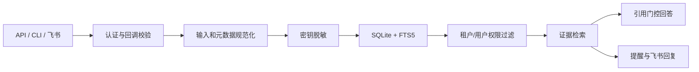

# 知澜（InfoMemory Agent）

> 把散落在消息、文档和本地文件里的信息，变成可追溯、可检索、按权限隔离的团队记忆。

[](https://github.com/zzbaichuan-glitch/infomemory-agent/actions/workflows/ci.yml)
[](https://github.com/zzbaichuan-glitch/infomemory-agent/actions/workflows/codeql.yml)

当前版本：`0.2.0`。项目仍处于 pre-1.0 阶段，但已从演示型 MVP 升级为可本地使用、可容器部署、具备明确生产安全边界的模块化单体。

## 现在能做什么

- 从 HTTP API、跨平台 CLI 和飞书文本事件写入记忆。
- 在持久化、索引、日志、LLM 和提醒派生之前，统一清洗正文、标题和来源元数据中的常见密钥、令牌、密码与私钥。
- 使用 SQLite FTS5 全文检索；所有读取在数据库查询层执行租户、所有者和可见性过滤。
- 生成基于证据的回答；有效陈述必须带 `[S1]` 引用，否则自动安全降级为证据列表。
- 支持资产游标分页、条件过滤、详情读取和所有者删除。
- 支持手动提醒、会议时间识别、提醒状态机和进程内通知 worker。
- 支持飞书回调 Token、Encrypt Key 解密、签名时效校验、事件幂等，以及“搜索 / 问 / 帮助”命令回复。
- 开发环境可使用可信身份头；生产环境强制使用严格校验的 HS256 Bearer Token。
- 提供统一错误结构、请求 ID、速率限制、结构化脱敏日志、存活/就绪探针和 OpenAPI。
- 提供 PowerShell 脚本、Docker Compose、Windows/Linux CI、CodeQL 和 Dependabot。

| 能力 | 当前状态 | 边界 |
|---|---|---|
| 本地文件与手工信息 | 可用 | UTF-8 文本通过 CLI/API 写入 |
| 飞书消息接入 | 可用 | 文本事件、验证、加密、签名、幂等 |
| 飞书搜索与问答 | 试点可用 | 回复仍在 webhook 内执行，尚无持久化任务队列 |
| 飞书云文档同步 | 待扩展 | 尚无 OAuth、增量同步与 ACL 撤销传播 |
| 检索 | 可用 | SQLite FTS5；尚无向量检索与重排 |
| LLM 问答 | 可选 | OpenAI-compatible；失败时安全降级 |
| 多实例部署 | 待扩展 | SQLite + 进程内 worker 适合单实例试点 |
| 桌面 GUI | 待扩展 | 当前提供 HTTP API 与 CLI |

## 安全模型



关键约束：

- `trusted_headers` 仅允许 development/test，production 会拒绝启动。
- Bearer Token 严格校验算法、签名、issuer、audience、时效、租户、用户和角色。
- 租户共享写入需要 `asset:share_tenant` 权限或 `knowledge_manager` 角色。
- 幂等范围包含租户、用户、操作和请求指纹；同一 key 配不同请求会冲突。
- 标题、正文、外部 ID 和来源 URL 都经过安全规范化；URL 仅接受安全协议。
- 飞书配置 Encrypt Key 后拒绝明文降级，签名采用恒定时间比较并限制时间窗口。
- 本项目不是密码库。真实密钥应进入 Secret Manager，知澜只保存安全引用。

详细边界见 [SECURITY.md](SECURITY.md)。

## 项目结构

```text
apps/api/                 Fastify API、认证、飞书适配器、Token 工具
packages/core/            领域服务、脱敏、检索、提醒、SQLite 仓储与迁移
scripts/                  安装、开发、验证、审计、冒烟与知澜 CLI
docs/api/openapi.yaml     OpenAPI 3.1 契约
docs/architecture/        架构与安全不变量
docs/plans/               PRD、实施计划和设计记录
.github/workflows/        CI 与 CodeQL
Dockerfile                非 root 多阶段镜像
compose.yaml              单实例部署示例
```

## 快速开始

要求 Node.js 24+、npm 11+；PowerShell 入口建议使用 PowerShell 7。

### 安装

```powershell
powershell -ExecutionPolicy Bypass -File .\scripts\install.ps1
```

实际调用链：

```text
scripts/install.ps1
└─ npm ci --cache .npm-cache --registry https://registry.npmjs.org
   ├─ 根 workspace
   ├─ packages/core
   └─ apps/api
```

跨平台可直接运行 `npm ci --registry=https://registry.npmjs.org`。

### 配置与开发启动

```powershell
Copy-Item .env.example .env.local
powershell -ExecutionPolicy Bypass -File .\scripts\dev.ps1
```

实际调用链：

```text
scripts/dev.ps1
└─ npm run dev --workspace @infomemory/api
   ├─ predev: npm run build --workspace @infomemory/core
   └─ tsx watch apps/api/src/server.ts
```

本地默认使用 `NODE_ENV=development`、`AUTH_MODE=trusted_headers`，并关闭 LLM 和飞书出站通知。`.env.local` 已被 Git 忽略。

默认端点：

- `GET /health/live`：存活
- `GET /health/ready`：SQLite 就绪
- `GET /health`：兼容健康页
- `GET /openapi.yaml`：OpenAPI 文档

### 使用 CLI

开发模式先设置身份：

```powershell
$env:INFOMEMORY_TENANT_ID = "demo-tenant"
$env:INFOMEMORY_USER_ID = "alice"
```

常用命令：

```powershell
npm run agent -- health
npm run agent -- ingest --file .\README.md --title "知澜项目说明"
npm run agent -- assets --limit 20
npm run agent -- search 知澜 安全
npm run agent -- ask 知澜的安全边界是什么
npm run agent -- remind --title "项目复盘" --starts-at "2026-09-01T02:00:00.000Z"
npm run agent -- reminders --status scheduled
npm run agent -- --help
```

入口链：

```text
npm run agent -- <command>
└─ node scripts/zhilan.mjs

powershell -File scripts/zhilan.ps1 <command>
└─ node scripts/zhilan.mjs
```

## 生产认证

真实部署应由 Secret Manager 注入至少 32 字节的随机密钥。下面仅演示本地 PowerShell：

```powershell
$env:AUTH_SECRET = [Convert]::ToBase64String([Security.Cryptography.RandomNumberGenerator]::GetBytes(48))
$env:AUTH_MODE = "bearer"
$env:AUTH_ISSUER = "infomemory-agent"
$env:AUTH_AUDIENCE = "infomemory-api"
$env:INFOMEMORY_TOKEN = npm run --silent token -- --tenant acme --user alice --roles member --expires-in 8h
```

Token 调用链：

```text
npm run token -- <args>
└─ npm run token --workspace @infomemory/api --
   └─ tsx apps/api/src/cli/generate-access-token.ts
      └─ apps/api/src/auth/access-token.ts
```

租户共享资产需要 `--roles member,asset:share_tenant` 或 `knowledge_manager`。生产还必须在入口层终止 HTTPS，并做好密钥轮换、备份加密与监控告警。

## HTTP API

| 方法 | 路径 | 用途 |
|---|---|---|
| GET | `/health/live` | 进程存活 |
| GET | `/health/ready` | SQLite 就绪 |
| GET | `/openapi.yaml` | OpenAPI 3.1 |
| POST | `/v1/assets` | 写入；必须带 `idempotency-key` |
| GET | `/v1/assets` | 游标分页与过滤 |
| GET/DELETE | `/v1/assets/:id` | 授权详情 / 所有者删除 |
| POST | `/v1/search` | 权限过滤的证据检索 |
| POST | `/v1/answers` | 引用门控问答 |
| POST/GET | `/v1/reminders` | 创建 / 查询提醒 |
| POST | `/v1/reminders/:id/status` | 推进提醒状态 |
| POST | `/v1/connectors/feishu/events` | 飞书回调 |

完整请求、响应、认证和错误结构见 [OpenAPI](docs/api/openapi.yaml)。普通 API 错误都包含稳定 `error`、安全 `message` 和 `requestId`。

## 飞书接入

1. 在飞书开放平台创建企业自建应用并启用机器人。
2. 配置事件地址 `https://你的域名/v1/connectors/feishu/events`。
3. 订阅 `im.message.receive_v1`，配置 Verification Token；推荐启用 Encrypt Key。
4. 需要命令回复/提醒时，授予最小消息发送权限，并配置 `FEISHU_APP_ID`、`FEISHU_APP_SECRET`、`FEISHU_NOTIFICATIONS_ENABLED=true`。
5. 使用 HTTPS；不要把 trusted-header 模式暴露到公网。

支持“帮助”“搜索 <关键词>”“问 <问题>”。普通文本会先脱敏再进入记忆并尝试识别会议时间；命令本身不会污染记忆。

当前命令在 webhook 内同步执行。公网飞书部署前应增加持久化 inbox/outbox、带租约的异步 worker、重试与死信队列，以满足快速 ACK 和故障恢复要求。

## 验证、测试与审计

```powershell
powershell -ExecutionPolicy Bypass -File .\scripts\verify.ps1
```

完整调用链：

```text
scripts/verify.ps1
├─ npm run typecheck
│  ├─ packages/core: tsc --noEmit
│  └─ apps/api: tsc --noEmit
├─ npm run test
│  ├─ packages/core: vitest run
│  └─ apps/api: vitest run
└─ npm run build
   ├─ packages/core: tsc
   └─ apps/api: tsc
```

独立入口：

- `scripts/test.ps1 → npm run test`
- `scripts/audit.ps1 → npm run audit:dependencies -- --cache .npm-cache`
- `scripts/smoke.ps1`：服务启动后的 trusted-header 或 Bearer 端到端冒烟；Bearer 模式先设置 `INFOMEMORY_TOKEN`。
- `scripts/acceptance.ps1`：完整验收演示，覆盖脱敏、幂等、检索、引用降级、权限隔离、提醒状态和删除。

验收演示入口链：

```text
powershell -ExecutionPolicy Bypass -File .\scripts\acceptance.ps1
└─ scripts/acceptance.ps1
   └─ HTTP /health、/v1/assets、/v1/search、/v1/answers、/v1/reminders
```

也可以直接运行根脚本：`npm run acceptance`。

## 生产启动

Node 入口：

```powershell
powershell -ExecutionPolicy Bypass -File .\scripts\start.ps1
```

```text
scripts/start.ps1
└─ npm run start --workspace @infomemory/api
   ├─ prestart: 构建 packages/core 与 apps/api
   └─ node apps/api/dist/server.js
```

Docker Compose：

```powershell
$env:AUTH_SECRET = "<从 Secret Manager 注入的至少 32 字节随机值>"
docker compose up --build -d
docker compose ps
Invoke-RestMethod http://127.0.0.1:3000/health/ready
```

停止：`docker compose down`。`Dockerfile` 使用多阶段构建、锁文件安装、生产依赖裁剪、非 root 用户和健康检查；`compose.yaml` 默认仅绑定本机环回地址，并持久化 `/app/var`。

## 明确的后续扩展

要进入大规模多租户生产，还需要：

- PostgreSQL、对象存储和可靠消息队列，替代 SQLite 与进程内 worker。
- 飞书 OAuth、云文档/知识库增量同步、来源 ACL 快照与撤销传播。
- 事务性连接器 inbox/outbox，消除 webhook 同步处理与进程崩溃窗口。
- 向量检索、重排、离线相关性评测与可观测性指标。
- 企业 SSO/JWKS 或独立身份服务，替代本地 HS256 签发器。
- 桌面端、全局快捷键、卡片确认与管理后台。

## 文档

- [v0.2 安全与可用性设计](docs/plans/2026-08-23-v0.2-secure-usability-design.md)
- [架构与安全不变量](docs/architecture/mvp-foundation.md)
- [产品需求文档](docs/plans/2026-08-19-information-memory-agent-prd.md)
- [贡献指南](CONTRIBUTING.md)
- [安全策略](SECURITY.md)
- [OpenAPI](docs/api/openapi.yaml)

## License

当前仓库尚未声明开源许可证。在添加明确的 `LICENSE` 前，默认保留全部权利。
